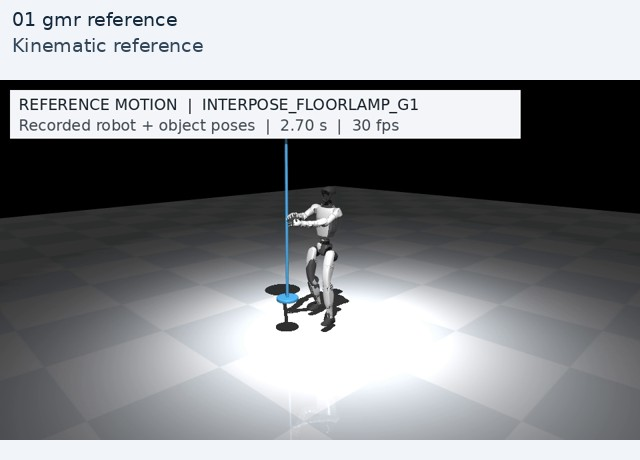
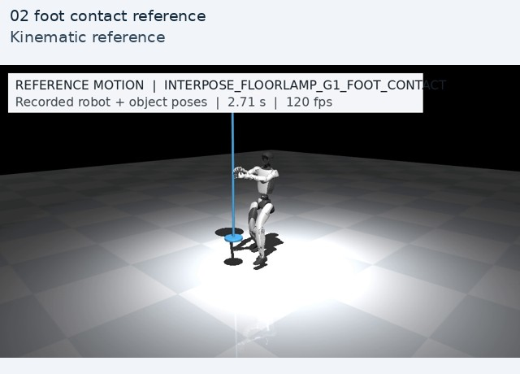
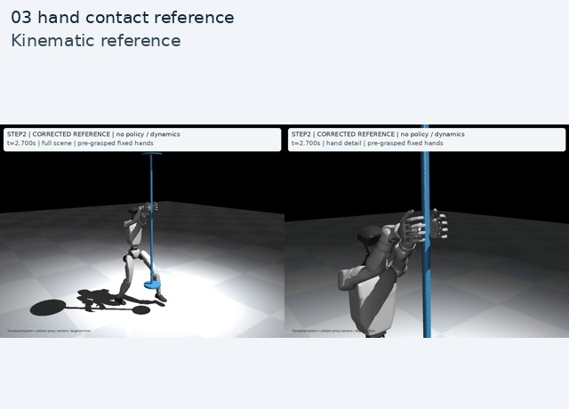
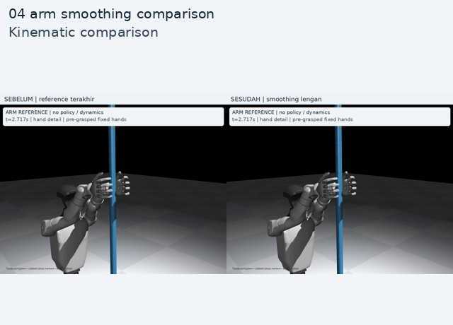
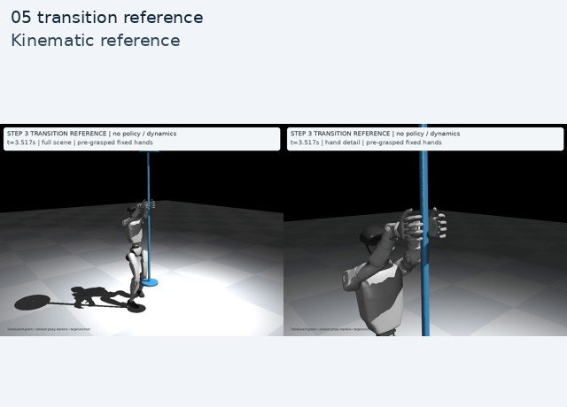
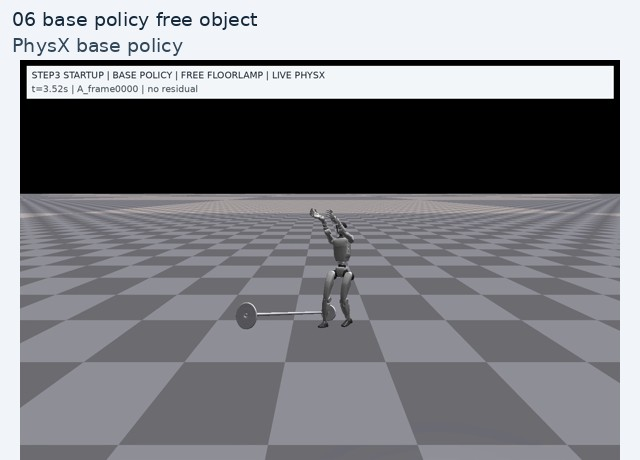
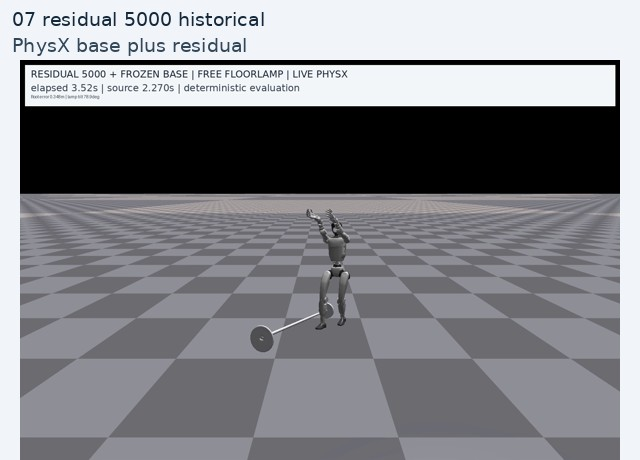
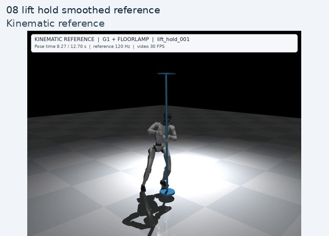
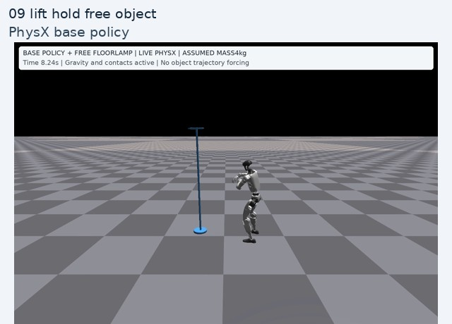

# ResMimic Experiments: Custom Data to G1

Reproducible InterPose-to-G1 reference conversion, contact correction, arm smoothing, synchronized startup transitions, and residual-policy experiments for **ResMimic**.

**Current result:** conversion and reference validation work; the recorded base-policy and 5,000-iteration residual experiments **do not successfully lift and carry the floorlamp**. The historical residual run also used a stale-timeout bug. This repository fixes that transition-information bug and includes a regression test. That fix alone does not establish physical manipulation success.

This README contains the setup, numbered experiment workflow, commands, data formats, and all nine video previews. The individual files in `docs/` remain available as focused guides.

## Contents

- [Repository contents and supported layout](#repository-contents-and-supported-layout)
- [Installation](#installation)
- [Step-by-step experiments](#step-by-step-experiments)
- [All nine experiment videos](#all-nine-experiment-videos)
- [Data formats and provenance](#data-formats-and-provenance)

<a id="repository-contents-and-supported-layout"></a>

## What is included

| Component | Purpose |
|---|---|
| `inputs/` | Minimal original InterPose `.npy` data, clock records, rest-object geometry, and a clip-specific correction seed |
| `tools/` | Portable inspection, alignment, GMR retargeting, validation, reference rendering, and publication checks |
| `pick_place_001/` | Selected foot/contact/smoothed/transition references, research code, physical assets, and the residual experiment |
| `lift_hold_001/` | Selected conversion and smoothed reference artifacts for the second dataset |
| `media/` | Nine selected reference/result videos with English captions and SHA-256 provenance |
| `docs/` | Setup, commands, data schemas, results, limitations, and troubleshooting |
| `publication/` | Explicit publication file list, dependency pins, input hashes, and validation evidence |

Large caches, temporary files, PID state, event logs, redundant attempts, and intermediate checkpoints remain local and are excluded from Git. The repository is an experiment package, not a backup of every local run.

## Supported installation layout

Install this repository at:

```text
ResMimic/
├── GMR/                       # pinned external dependency
├── assets/, legged_gym/, pose/, rsl_rl/
└── InterPose/
    └── custom_data/            # this repository
```

Pinned dependencies:

- ResMimic: `0d54d07d8552484b9a37579c8e08e93edd59a0f5`
- GMR: `25f56db79ac411258b377b6d4ccba0c8ff3372ac`
- Geometry environment: Python 3.11; simulation environment: Python 3.8 with Isaac Gym Preview 4.

Geometry conversion does not require Isaac Gym or a trained policy. Physical evaluation and residual training require an NVIDIA GPU and the simulation environment. GMR, simulator binaries, SMPL body models, and third-party environment installations are not bundled.

<a id="installation"></a>

## Installation

Use Linux x86-64. The commands below keep geometry tools separate from the legacy Isaac Gym environment. Run installation commands yourself in the intended environment; the publication process does not install or accept simulator licenses for you.

### 1. Clone pinned dependencies and this repository

```bash
git clone https://github.com/badriawan/ResMimic.git
cd ResMimic
git checkout 0d54d07d8552484b9a37579c8e08e93edd59a0f5
git clone https://github.com/YanjieZe/GMR.git GMR
git -C GMR checkout 25f56db79ac411258b377b6d4ccba0c8ff3372ac
mkdir -p InterPose
git clone https://github.com/badriawan/ResMimic_experiments.git InterPose/custom_data
export RESMIMIC_ROOT="$PWD"
cd InterPose/custom_data
```

If `GMR` or `InterPose/custom_data` already exists, inspect it and reuse the intended checkout; do not clone over existing work. `publication/github_status.json` records the publication state and verified destination of a local preparation.

### 2. Geometry / GMR environment

With Conda already installed:

```bash
conda create -n resmimic-geometry python=3.11 -y
conda activate resmimic-geometry
python -m pip install -r requirements/geometry-tested.txt
python -m pip install -e "$RESMIMIC_ROOT/GMR"
export GMR_PYTHON="$(command -v python)"
```

GMR installation may resolve additional dependencies described by its pinned `pyproject.toml`. The bundled source skeleton already contains positions and local rotations, so this conversion does not reconstruct a human surface or require SMPL body-model weights. See the [pinned GMR project](https://github.com/YanjieZe/GMR/tree/25f56db79ac411258b377b6d4ccba0c8ff3372ac) for its own requirements and licenses.

`geometry-tested.txt` records the core versions used for the publication checks; it is not an exhaustive transitive environment lock. `geometry.txt` contains broader compatibility ranges for an explicitly revalidated alternative environment.

Check the geometry environment:

```bash
bash tools/run_geometry.sh doctor
bash tools/run_geometry.sh inspect --dataset pick_place_001
python tools/check_publication.py
```

`GMR_PYTHON` is an absolute interpreter path. If it is unset, the local development layout also recognizes `ResMimic/thirdparty/gmr_omomo/bin/python`. Do not use Python 3.8 for GMR's geometry environment.

### 3. Simulation environment

Isaac Gym Preview 4 is an external NVIDIA dependency. Obtain/install it under its applicable terms; this repository does not redistribute the SDK. Follow [NVIDIA's Isaac Gym page](https://developer.nvidia.com/isaac-gym) and the pinned ResMimic instructions. A typical environment setup, after making the SDK available locally, is:

```bash
conda create -n resmimic-sim python=3.8 -y
conda activate resmimic-sim
python -m pip install torch==2.4.1 torchvision==0.19.1 --index-url https://download.pytorch.org/whl/cu121
export ISAAC_GYM_PATH=/absolute/path/to/isaacgym
python -m pip install -e "$ISAAC_GYM_PATH/python"
python -m pip install -e "$RESMIMIC_ROOT/rsl_rl" -e "$RESMIMIC_ROOT/pose" -e "$RESMIMIC_ROOT/legged_gym"
python -m pip install -r requirements/simulation.txt
export RESMIMIC_PYTHON="$(command -v python)"
```

Use a driver compatible with the chosen CUDA/PyTorch build. The recorded physical experiments ran on an NVIDIA RTX 4070 Ti SUPER with 16 GB VRAM. Default training uses 32 environments and small minibatches; actual VRAM availability still matters.

System prerequisites include a working C++ compiler, EGL/OpenGL libraries and DejaVu fonts for recorded captions. On a minimal Ubuntu installation these may require installing `build-essential`, `libegl1`, `libgl1` and `fonts-dejavu-core` through your system package manager. Do not install the SDK or accept third-party terms automatically through an unreviewed helper.

TensorBoard 2.14 uses `protobuf<5` in the pinned ResMimic requirements. The historical server had protobuf 5.29.6 installed despite that constraint; the new requirements follow the dependency constraint instead of reproducing that mismatch.

### 4. Prepare the frozen base checkpoint

```bash
python3 tools/prepare_assets.py
```

This verifies the base policy already supplied by pinned ResMimic and copies it to the local experiment path. It performs no download, training, or SDK installation. Expected SHA-256:

```text
fd98a2af49b8c1b3e39a57b503272db0dacc0d56c7e68d1c8dddfbd9cb9d931c
```

### 5. Run simulation checks before training

```bash
TASK=pick_place_001/residual_policy/after_tuning
bash "$TASK/launch_python.sh" "$PWD/$TASK/scripts/train_residual.py" --check-only
bash "$TASK/launch_python.sh" "$PWD/$TASK/tests/check_timeout_transition.py"
bash "$TASK/launch_python.sh" "$PWD/$TASK/tests/check_cpu.py"
```

The first command checks inputs/configuration. The latter commands exercise CPU fixtures and actual runner/network interfaces; they do not prove physical grasp success. Then use the short GPU preflight/training commands in [EXPERIMENTS.md](#step-by-step-experiments).

### Environment variables in each terminal

```bash
export RESMIMIC_ROOT=/absolute/path/to/ResMimic
export GMR_PYTHON=/absolute/path/to/geometry/environment/bin/python
export RESMIMIC_PYTHON=/absolute/path/to/simulation/environment/bin/python
cd "$RESMIMIC_ROOT/InterPose/custom_data"
```

The historical fixed interpreter path is only a fallback. New commands should use these explicit overrides when reproducing on another machine. Do not point the simulation launcher at the geometry interpreter.

<a id="step-by-step-experiments"></a>

## Step-by-step experiments

Complete [installation](#installation) first. Commands below run from this repository root, `ResMimic/InterPose/custom_data`, with `GMR_PYTHON`, `RESMIMIC_PYTHON` and `RESMIMIC_ROOT` set. Each scientific attempt uses a new name/output directory.

The main experiment is `pick_place_001`. A second section covers `lift_hold_001`. Do not substitute its differently scaled data into the pick/place-specific correction scripts.

### 1. Inspect the original input

```bash
bash tools/run_geometry.sh doctor
bash tools/run_geometry.sh inspect --dataset pick_place_001
```

Input: `inputs/pick_place_001/motion.npy` and `clock.npz`. Inspect units, quaternion convention, frame counts, original clocks, and joint metadata. The NPY is a trusted dictionary of human and object motion, not G1 joint commands.

Expected: 127 source frames at 30 Hz. Stop if units, joint hierarchy or object geometry differ from the dataset configuration.

### 2. Align and retarget through GMR

```bash
bash tools/run_geometry.sh align --dataset pick_place_001 --output outputs/pick_place_run01
bash tools/run_geometry.sh retarget --dataset pick_place_001 --output outputs/pick_place_run01
bash tools/run_geometry.sh validate \
  --motion outputs/pick_place_run01/motion.pkl \
  --report outputs/pick_place_run01/validation.json
bash tools/run_geometry.sh render \
  --motion outputs/pick_place_run01/motion.pkl \
  --object-mesh outputs/pick_place_run01/floorlamp.obj \
  --output outputs/pick_place_run01/reference.mp4
```

Outputs: `aligned.npz`, `qpos.npy`, `motion.pkl`, paired `motion.npz`, `floorlamp.obj`, IK configuration and reports. Expected common-clock length: **126 frames, 30 Hz, 4.166667 s between endpoints**.

The exporter composes human local rotations through the parent hierarchy, applies one common scene scale, solves GMR/Mink IK, reorders 29 robot joints by name, and calculates the 38-link skeleton with target URDF FK. No physics or policy runs here.

Recorded reference: [Video 01](#video-01). The initial GMR motion still has poor floor/contact geometry; native schema/joint-limit PASS is not approval for training.

### 3. Reproduce the clip-specific foot correction

```bash
"$GMR_PYTHON" -I -B tools/correct_pick_place_feet.py \
  --motion "$PWD/outputs/pick_place_run01/motion.pkl" \
  --aligned "$PWD/outputs/pick_place_run01/aligned.npz" \
  --output-dir "$PWD/outputs/pick_place_feet01"

bash tools/run_geometry.sh validate \
  --motion outputs/pick_place_feet01/interpose_floorlamp_g1_foot_contact.pkl \
  --report outputs/pick_place_feet01/schema_validation.json
```

Expected: 501 frames at 120 Hz, a paired object NPZ, `measurements.json`, solver traces and stance diagnostics. Inspect every gate in `measurements.json`; do not continue with a failed candidate.

This correction is deliberately specific to the bundled 126-frame source. Its inferred swing schedule and earlier upper-body/root seed are supplied in the repository; the seed preserves a prior 7.5 cm pelvis-height correction. The script is not a universal contact estimator for arbitrary new motions. It never claims measured foot forces or dynamic balance.

The selected historical accepted result is also available directly at:

```text
pick_place_001/data_ready_for_policy/p1_attempt09/interpose_floorlamp_g1_foot_contact.pkl
pick_place_001/data_ready_for_policy/p1_attempt09/interpose_floorlamp_g1_foot_contact.npz
```

Recorded result: [Video 02](#video-02).

### 4. Inspect and branch the coupled hand/object correction

The accepted hand/object reference is supplied so you can reproduce downstream experiments without repeating the original parameter search:

```bash
STEP2="$PWD/pick_place_001/demo_object_base_policy/step_2_contact"
CONTACT="$STEP2/reference_corrected/interpose_floorlamp_g1_hand_contact.pkl"

"$GMR_PYTHON" -I -B "$STEP2/scripts/validate_reference.py" \
  --candidate "$CONTACT" --rate 600 --tag user_contact_validation01

"$GMR_PYTHON" -I -B "$STEP2/scripts/render_reference.py" \
  --candidate "$CONTACT" --output "$STEP2/results/user_contact_reference01"
```

Inputs include the paired PKL/NPZ, `contact_plan.json`, source colliders, and G1 URDF. The reference uses opposing fixed-palm patches, a consistent object-frame contact target and no active gripper.

To create an experimental alternative from the foot-contact reference:

```bash
PICK_PLACE_FOOT_REFERENCE="$PWD/outputs/pick_place_feet01/interpose_floorlamp_g1_foot_contact.pkl" \
"$GMR_PYTHON" -I -B "$STEP2/scripts/solve_contact_reference.py" \
  --name user_contact01 --self-seed --patch side
```

Validate the new candidate independently before using it. A solver candidate is not automatically accepted, and changing the grip/path parameters can violate collision or joint limits. The supplied accepted reference is a checkpoint from the earlier coupled/temporal tuning sequence; the short alternative command does not claim to repeat every historical optimization decision.

Recorded accepted reference: [Video 03](#video-03).

### 5. Inspect or regenerate arm smoothing

```bash
ARMS="$STEP2/arm_smoothing"
SMOOTH="$ARMS/reference_smoothed/interpose_floorlamp_g1_hand_contact.pkl"

"$GMR_PYTHON" -I -B "$ARMS/scripts/validate_reference.py" \
  --candidate "$SMOOTH" --rate 2400 --tag user_smoothed_validation01
```

To generate another smoothing candidate from the accepted contact checkpoint:

```bash
export PICK_PLACE_CONTACT_REFERENCE="$CONTACT"
"$GMR_PYTHON" -I -B "$ARMS/scripts/smooth_arms.py" \
  --name user_smoothing01 --iterations 15 \
  --collision-weight 100000 --tangent-weight 150
```

Then validate `"$ARMS/candidates/user_smoothing01/interpose_floorlamp_g1_hand_contact.pkl"` with a new tag. The objective reduces arm acceleration/jerk while constraining contacts and preserving root/legs/waist/object paths. The published accepted result used a previous smoothing candidate as its seed; a new unseeded attempt can produce different values and must pass its own checks.

Recorded comparison: [Video 04](#video-04).

### 6. Generate and validate the shared startup transition

```bash
STEP3="$PWD/pick_place_001/demo_object_base_policy/step_3_transition"
export PICK_PLACE_SMOOTHED_REFERENCE="$SMOOTH"

"$GMR_PYTHON" -I -B "$STEP3/scripts/build_transition.py" \
  --name user_transition01 --start-frame 0 --hold 0.75 --ramp 1.0

"$GMR_PYTHON" -I -B "$STEP3/scripts/validate_transition.py" \
  --candidate "$STEP3/candidates/user_transition01/interpose_floorlamp_g1_transition.pkl" \
  --rate 2400 --tag user_transition_validation01
```

The selected transition is also supplied at `step_3_transition/data_final_reference_transition/`. It has **2,601 frames at 480 Hz**, a 0.75 s exact stationary prefix, a 1 s source-clock ramp and an exact 1× source suffix. `transition_clock.npz` records the mapping. Both robot and lamp follow that mapping; resetting only robot velocity would not create a consistent reference.

Recorded reference replay: [Video 05](#video-05). A smooth reference clock does not eliminate all source pose-derivative discontinuities or prove physical stability.

### 7. Evaluate the frozen base with the free floorlamp

Prepare the base checkpoint first, then render the supplied historical experiment configuration with residual actions disabled:

```bash
python3 tools/prepare_assets.py
TASK="$PWD/pick_place_001/residual_policy/after_tuning"
HISTORICAL="$TASK/runs/20261114T121525_338256Z/model_5000.pt"

bash "$TASK/render_latest.sh" --checkpoint "$HISTORICAL" --base-only
```

The renderer restores the saved environment configuration, rebases historical paths to your checkout, and runs a single bounded deterministic physical rollout. No optimizer update occurs. The supplied residual checkpoint provides compatible run metadata; residual actions are zero in `--base-only` mode.

Outputs appear in a new `"$TASK/evaluations/"` folder, including `base_policy_physx.mp4`, state arrays and `result.json`. This new rendering uses the saved training environment configuration; it is not asserted to be byte-identical to the earlier Step 3 probe, whose termination settings differ.

Recorded Step 3 free-object base-policy result: [Video 06](#video-06). Startup improved, but carrying failed.

### 8. Check the corrected residual pipeline

```bash
bash "$TASK/launch_python.sh" "$TASK/scripts/train_residual.py" --check-only
bash "$TASK/launch_python.sh" "$TASK/tests/check_timeout_transition.py"
bash "$TASK/launch_python.sh" "$TASK/tests/check_cpu.py"
bash "$TASK/launch_python.sh" "$TASK/scripts/train_residual.py" preflight --num-envs 4
```

The timeout regression must pass the endpoint → ordinary transition case. GPU preflight performs forward inference, a physical step and subset reset, but no PPO optimizer update. A PASS is pipeline evidence, not lift/carry evidence.

Residual input: 1,764 features including current object pose. Frozen-base input: the original raw 1,757 features. Critic input: 1,741 features. Saved residual/critic normalizers are separate from the base's embedded normalization. Future features are fully masked in this configuration. The object is a free 4 kg actor, with no weld or support force.

### 9. Start short background training and TensorBoard

```bash
bash "$TASK/run_training.sh" start --num-envs 4 --iterations 20
bash "$TASK/run_training.sh" status
tail -f "$TASK/state/training_latest.log"
```

TensorBoard starts automatically at **http://localhost:6006**. On a remote server, forward port 6006 through your editor or SSH. The training/TensorBoard processes are detached from the terminal; do not add another `&` or `nohup`.

Wait for training to stop, then inspect its `training_validation.json`, `progress.json`, losses and error curves. A 20-iteration test is intended to cross episode boundaries if the policy survives long enough. If it fails, inspect `failure.json` and the log before continuing.

### 10. Start a longer experimental run

After the short run completes successfully:

```bash
bash "$TASK/run_training.sh" start --num-envs 32 --iterations 5000
```

Default rollout batch: 32 × 24 samples, split into three minibatches of 256. Each invocation starts a new residual; it does not resume the historical buggy run. Existing owned TensorBoard can be reused. For another port, add `--port 6007`. For less VRAM, try `--num-envs 16`.

```bash
bash "$TASK/run_training.sh" stop       # training only; cooperative iteration-boundary save
bash "$TASK/run_training.sh" stop-all   # training and its TensorBoard
```

SIGTERM is given up to 30 seconds for a cooperative save before forced termination. A new checkpoint cannot be guaranteed after a crash/forced kill. No automatic resume or reboot service is installed.

Outputs: `runs/<timestamp>/model_<iteration>.pt`, `training.log`, `tensorboard/events.*`, configurations, provenance, update metrics, progress and completion/failure records. Runtime outputs are ignored by the publication allowlist unless you explicitly curate a result.

### 11. Render the latest trained checkpoint

```bash
bash "$TASK/render_latest.sh"
```

Or specify a checkpoint explicitly:

```bash
bash "$TASK/render_latest.sh" --checkpoint "$HISTORICAL"
```

The latter reproduces the historical failed 5,000-iteration policy, even though the current trainer's timeout metadata has been repaired. Loading its saved weights does not turn it into a corrected-training checkpoint. [Video 07](#video-07).

Read `result.json`: lift height/floor clearance, tilt, contact indicators, tracking error, stop reason and input hashes. Do not treat episode survival or a finite reward as grasp/carry success.

### 12. Repeat conversion for the lift/hold dataset

```bash
bash tools/run_geometry.sh inspect --dataset lift_hold_001
bash tools/run_geometry.sh align --dataset lift_hold_001 --output outputs/lift_hold_run01
bash tools/run_geometry.sh retarget --dataset lift_hold_001 --output outputs/lift_hold_run01
bash tools/run_geometry.sh validate --motion outputs/lift_hold_run01/motion.pkl
bash tools/run_geometry.sh render \
  --motion outputs/lift_hold_run01/motion.pkl \
  --object-mesh outputs/lift_hold_run01/floorlamp.obj \
  --output outputs/lift_hold_run01/reference.mp4
```

This dataset uses scale 1.0 and a different recorder clock. Its accepted smoothed lowering pair is supplied under `lift_hold_001/data_tuning_remove_vibration/v2_final/`; the original correction/smoothing research sources are retained in `converter/scripts/` for provenance. Those legacy tools have additional scene/attempt dependencies and are not the portable quick-start entry point.

[Smoothed reference Video 08](#video-08) and [free-object base-policy Video 09](#video-09) show different kinds of evidence. The published residual task is currently configured specifically for the selected pick/place Step 3 pair; do not point it at arbitrary lift/hold data without adapting and validating its configuration and initialization contract.

### Publication validation scope

See [publication validation](publication/validation.json) for the actual checks run on the prepared package, including any clean-checkout tests and bounded physical smoke tests. A fresh dependency installation and successful long corrected training must not be inferred from CPU/mocked checks.

<a id="all-nine-experiment-videos"></a>

## All nine experiment videos

Every published video is shown below with its preview, dataset, recording type, duration, and interpretation. Click a preview to open the repository MP4, or use **Watch / download MP4** for the video file directly. GitHub may open its file viewer rather than play a clip inline.

For a local browser video player, run this command from the repository root:

```bash
python3 -m http.server 8000 --bind 127.0.0.1
```

Open **http://localhost:8000/docs/videos.html**. This serves the existing videos; it starts no simulator or training process. Reference replay shows stored poses. A PhysX rollout shows policy actions with a free physical object.

<a id="video-01"></a>

### 01. Initial GMR reference

[](media/01_gmr_reference.mp4)

[Watch / download MP4](https://github.com/badriawan/ResMimic_experiments/raw/refs/heads/main/media/01_gmr_reference.mp4) · **Dataset:** `pick_place_001` · **Type:** Kinematic reference · **Duration:** 4.20 s

Initial GMR retargeting; no policy or physics.

<a id="video-02"></a>

### 02. Foot-contact corrected reference

[](media/02_foot_contact_reference.mp4)

[Watch / download MP4](https://github.com/badriawan/ResMimic_experiments/raw/refs/heads/main/media/02_foot_contact_reference.mp4) · **Dataset:** `pick_place_001` · **Type:** Kinematic reference · **Duration:** 4.17 s

Foot-contact corrected reference; no learned-policy success claim.

<a id="video-03"></a>

### 03. Coupled hand–floorlamp reference

[](media/03_hand_contact_reference.mp4)

[Watch / download MP4](https://github.com/badriawan/ResMimic_experiments/raw/refs/heads/main/media/03_hand_contact_reference.mp4) · **Dataset:** `pick_place_001` · **Type:** Kinematic reference · **Duration:** 4.20 s

Opposing fixed-palm reference contact on the lamp collider.

<a id="video-04"></a>

### 04. Arm smoothing comparison

[](media/04_arm_smoothing_comparison.mp4)

[Watch / download MP4](https://github.com/badriawan/ResMimic_experiments/raw/refs/heads/main/media/04_arm_smoothing_comparison.mp4) · **Dataset:** `pick_place_001` · **Type:** Kinematic comparison · **Duration:** 4.18 s

Before/after constrained arm smoothing; remaining vibration can occur.

<a id="video-05"></a>

### 05. Synchronized startup transition

[](media/05_transition_reference.mp4)

[Watch / download MP4](https://github.com/badriawan/ResMimic_experiments/raw/refs/heads/main/media/05_transition_reference.mp4) · **Dataset:** `pick_place_001` · **Type:** Kinematic reference · **Duration:** 5.43 s

Selected A: 0.75 s hold and 1.0 s shared robot/object clock ramp.

<a id="video-06"></a>

### 06. Base policy with a free floorlamp

[](media/06_base_policy_free_object.mp4)

[Watch / download MP4](https://github.com/badriawan/ResMimic_experiments/raw/refs/heads/main/media/06_base_policy_free_object.mp4) · **Dataset:** `pick_place_001` · **Type:** PhysX base policy · **Duration:** 5.42 s

Startup improves; physical lift/carry still fails.

<a id="video-07"></a>

### 07. Historical residual policy: 5,000 iterations

[](media/07_residual_5000_historical.mp4)

[Watch / download MP4](https://github.com/badriawan/ResMimic_experiments/raw/refs/heads/main/media/07_residual_5000_historical.mp4) · **Dataset:** `pick_place_001` · **Type:** PhysX base plus residual · **Duration:** 5.42 s

Historical 5000-iteration run with the timeout bug; lamp falls. Not a corrected-training result.

<a id="video-08"></a>

### 08. Lift/hold: smoothed reference

[](media/08_lift_hold_smoothed_reference.mp4)

[Watch / download MP4](https://github.com/badriawan/ResMimic_experiments/raw/refs/heads/main/media/08_lift_hold_smoothed_reference.mp4) · **Dataset:** `lift_hold_001` · **Type:** Kinematic reference · **Duration:** 12.73 s

Smoothed lift/hold/lowering reference; replay is not a physical success test.

<a id="video-09"></a>

### 09. Lift/hold: base policy with a free floorlamp

[](media/09_lift_hold_free_object.mp4)

[Watch / download MP4](https://github.com/badriawan/ResMimic_experiments/raw/refs/heads/main/media/09_lift_hold_free_object.mp4) · **Dataset:** `lift_hold_001` · **Type:** PhysX base policy · **Duration:** 12.70 s

Free-object floorlamp experiment; manipulation is not certified successful.

<a id="data-formats-and-provenance"></a>

## Data formats and provenance

### Two different NPZ roles

The source InterPose NPY is a trusted, project-generated dictionary containing human joint positions, local axis-angle rotations, object poses and metadata. Retargeting does not consist of changing a filename extension.

```text
InterPose motion.npy + clock.npz
          |
          v
aligned.npz (human and object at a common clock)
          |                            |
          v                            v
GMR/Mink IK -> qpos.npy       object coordinate transform
          |                            |
          v                            v
motion.pkl (G1 robot)         motion.npz (floorlamp)
```

Never load an arbitrary untrusted pickle/NPY object dictionary. The input manifest records hashes of the bundled trusted experiment files.

### Exported motion pair

| File / field | Shape | Meaning |
|---|---|---|
| PKL `fps` | scalar | Sampling rate shared by robot/object reference |
| PKL `root_pos` | `[T,3]` | Robot root world position, meters |
| PKL `root_rot` | `[T,4]` | Robot root quaternion, XYZW |
| PKL `dof_pos` | `[T,29]` | G1 joint angles in target URDF joint order, radians |
| PKL `local_body_pos` | `[T,38,3]` | URDF forward-kinematic link positions in pelvis frame |
| PKL `link_body_list` | 38 names | Link order for the FK array |
| NPZ `trans` | `[T,3]` | Object world translation, meters |
| NPZ `rot` | `[T,4]` | Object quaternion, XYZW |
| NPZ `source_time_s` | `[T]` | Original capture clock mapped to exported samples |

The robot/object files must stay paired. The object NPZ does not contain robot motor commands or measured physical grip forces.

`qpos.npy` is a separate intermediate: `[T,36] = root XYZ + root WXYZ + 29 joint angles in GMR XML order`. It is not the final PKL layout. The exporter converts quaternion order and reorders joints by name before saving the final motion pair.

### Dataset-specific differences

| Property | `pick_place_001` | `lift_hold_001` |
|---|---|---|
| Original source length | 127 frames | 383 frames |
| Source rate | 30 Hz | 30 Hz |
| Common-clock export | 126 frames | 382 frames |
| Common scene scale | 0.9 | 1.0 |
| Clock source | Stage-10 measured human / derived object clock map | Recorder reference clock / derived object index clock |
| Origin convention | First aligned pelvis XY | First source pelvis XY |

The common-clock export retains supported overlap only, without inventing out-of-range samples. Positions use linear interpolation; local human rotations and object orientation use SLERP. Human local rotations are composed through the SMPL-X parent tree before IK. The first 22 human bodies provide IK targets; the extra two hand markers are not robot DOFs.

Scale and XY origin changes apply consistently to human targets, the object trajectory, and the object rest mesh. The rest mesh is not silently recentered. The original datasets therefore cannot share a single hardcoded scaling assumption.

### Selected reference checkpoints

The package contains the initial raw conversion, the accepted foot-contact intermediate, the accepted coupled hand/object reference, the accepted arm-smoothed reference, and the selected startup-transition reference. The transition adds a 0.75-second stationary reference and a 1-second clock-rate ramp to both robot and lamp. The selected final reference has 2,601 frames at 480 Hz and endpoint duration 5.416667 seconds.

The lift/hold dataset also includes its selected smoothed lowering reference. These are saved experimental checkpoints, not interchangeable representations of one dataset.

### Ownership and upstream material

- InterPose-generated motions and recording clocks are user-supplied experiment artifacts; their provenance is preserved in `publication/input_manifest.json`.
- The floorlamp rest geometry originated in the InterPose processed-object assets. The code license does not grant new rights to the underlying object dataset.
- Robot models remain in pinned GMR/ResMimic dependencies. Their upstream notices still apply.
- The frozen base checkpoint is obtained from the pinned ResMimic checkout, not relicensed by this package.
- The included historical residual checkpoint is an experimental result derived from those dependencies; it is supplied to reproduce the recorded failed evaluation.
- Videos show reference replay or simulator output; each clip's type is recorded in `media/manifest.json`.

No SDK binaries, Conda environments, human body-model weights, or unrelated scene datasets are included. Consult [THIRD_PARTY_NOTICES.md](THIRD_PARTY_NOTICES.md) before redistributing upstream data/assets.
