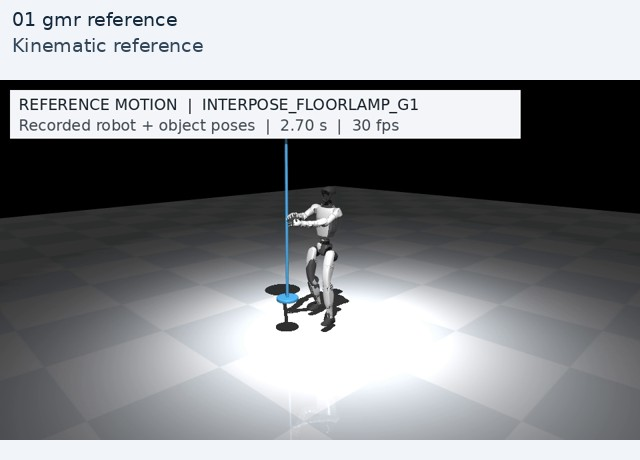
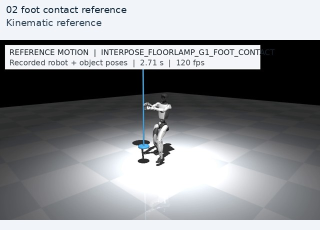
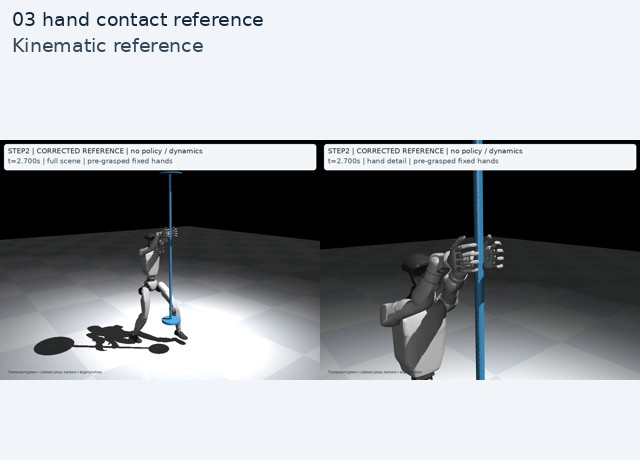
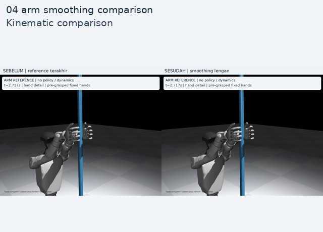
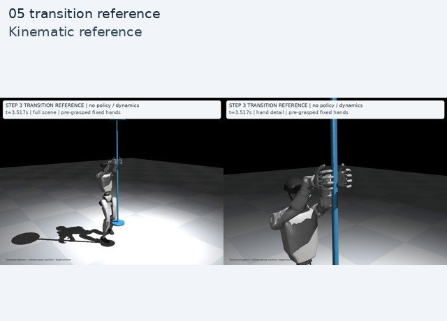
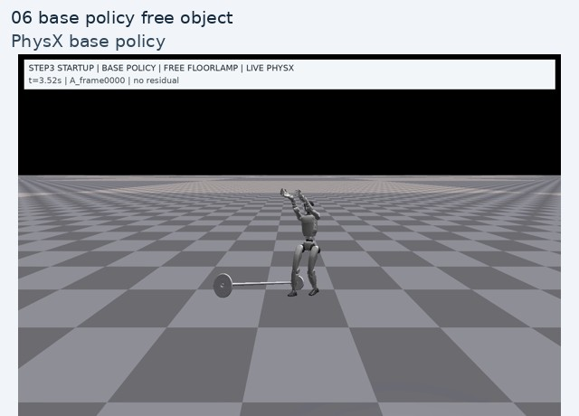
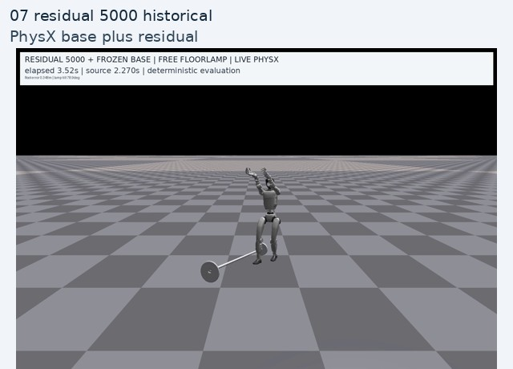
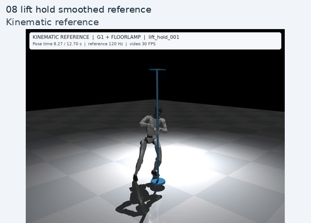
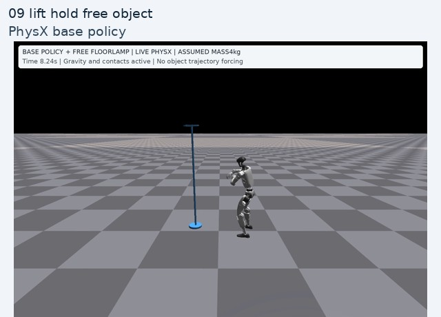

# Video gallery

All clips are existing experiment results. Reference replay and physical policy evaluation are labeled separately. Click an image/title to open the MP4. GitHub may show a file page; use Raw/Download when needed. For an HTML video player, run `python3 -m http.server 8000 --bind 127.0.0.1` at the repository root and open `http://localhost:8000/docs/videos.html`.

## 01 gmr reference

**Dataset:** `pick_place_001` · **Type:** Kinematic reference · **Duration:** 4.20 s

Initial GMR retargeting; no policy or physics.

## 02 foot contact reference

**Dataset:** `pick_place_001` · **Type:** Kinematic reference · **Duration:** 4.17 s

Foot-contact corrected reference; no learned-policy success claim.

## 03 hand contact reference

**Dataset:** `pick_place_001` · **Type:** Kinematic reference · **Duration:** 4.20 s

Opposing fixed-palm reference contact on the lamp collider.

## 04 arm smoothing comparison

**Dataset:** `pick_place_001` · **Type:** Kinematic comparison · **Duration:** 4.18 s

Before/after constrained arm smoothing; remaining vibration can occur.

## 05 transition reference

**Dataset:** `pick_place_001` · **Type:** Kinematic reference · **Duration:** 5.43 s

Selected A: 0.75 s hold and 1.0 s shared robot/object clock ramp.

## 06 base policy free object

**Dataset:** `pick_place_001` · **Type:** PhysX base policy · **Duration:** 5.42 s

Startup improves; physical lift/carry still fails.

## 07 residual 5000 historical

**Dataset:** `pick_place_001` · **Type:** PhysX base plus residual · **Duration:** 5.42 s

Historical 5000-iteration run with the timeout bug; lamp falls. Not a corrected-training result.

## 08 lift hold smoothed reference

**Dataset:** `lift_hold_001` · **Type:** Kinematic reference · **Duration:** 12.73 s

Smoothed lift/hold/lowering reference; replay is not a physical success test.

## 09 lift hold free object

**Dataset:** `lift_hold_001` · **Type:** PhysX base policy · **Duration:** 12.70 s

Free-object floorlamp experiment; manipulation is not certified successful.
